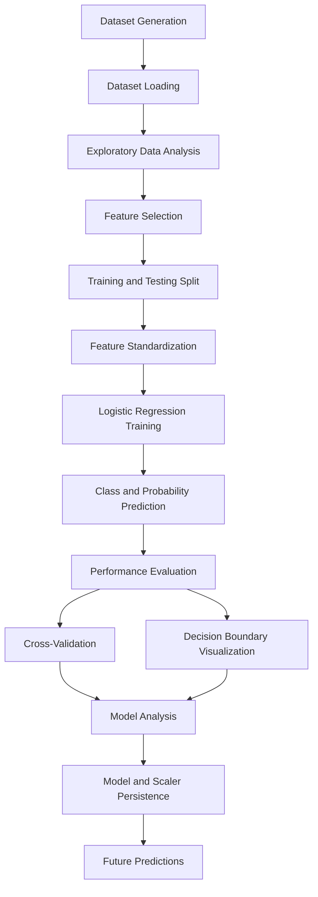
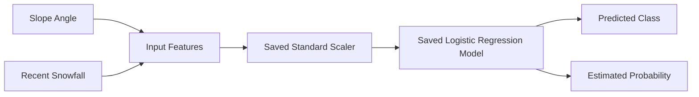

# 🏔️ Avalanche Occurrence Prediction Using Logistic Regression


> A supervised machine learning project that predicts avalanche occurrence based on slope steepness and recent snowfall using Logistic Regression.

---

## 📌 Project Overview

Avalanches are natural hazards influenced by terrain characteristics, snowfall accumulation, weather conditions and snowpack stability. Identifying patterns associated with avalanche occurrence can contribute to research in environmental monitoring and natural hazard assessment.

This project implements a **Logistic Regression classification model** to estimate the probability of avalanche occurrence using two primary environmental features: slope angle and fresh snowfall.

The project covers the complete machine learning workflow, including exploratory data analysis, feature selection, standardization, model training, performance evaluation, cross-validation, decision boundary visualization and model serialization.

The implementation is designed for academic learning and demonstrates how binary classification techniques can be applied to environmental risk modelling.

---

## 📑 Table of Contents

- [Project Objectives](#-project-objectives)
- [Key Features](#-key-features)
- [Technology Stack](#-technology-stack)
- [Dataset Description](#-dataset-description)
- [Exploratory Data Analysis](#-exploratory-data-analysis)
- [Machine Learning Methodology](#-machine-learning-methodology)
- [Project Workflow](#-project-workflow)
- [Model Performance](#-model-performance)
- [Key Findings](#-key-findings)
- [Model Persistence](#-model-persistence)
- [Repository Structure](#-repository-structure)
- [Installation and Usage](#-installation-and-usage)
- [Potential Applications](#-potential-applications)
- [Limitations](#-limitations)
- [Future Enhancements](#-future-enhancements)
- [Learning Outcomes](#-learning-outcomes)
- [Author](#-author)

---

## 🎯 Project Objectives

- Develop a binary classification model for avalanche occurrence prediction.
- Analyse the relationship between slope steepness, snowfall and avalanche occurrence.
- Implement Logistic Regression using relevant environmental features.
- Standardize numerical input features before model training.
- Evaluate classification performance using multiple statistical metrics.
- Assess model generalization through five-fold cross-validation.
- Visualize classification regions using a two-dimensional decision boundary.
- Save the trained model and preprocessing component for future predictions.
- Demonstrate the application of machine learning in natural hazard research.

---

## ✨ Key Features

- 📊 Structured dataset containing 600 avalanche-related observations.
- 🔍 Exploratory data analysis and feature investigation.
- 🧹 Data preparation and feature standardization.
- 🧠 Logistic Regression-based binary classification.
- 📐 Two-dimensional decision boundary visualization.
- 🎯 Avalanche occurrence probability estimation.
- 📈 ROC-AUC and classification performance evaluation.
- 🔄 Five-fold cross-validation.
- 💾 Trained model and scaler serialization.
- 🧪 Synthetic dataset generation.
- 📓 Interactive Jupyter Notebook implementation.
- ♻️ Reusable machine learning workflow.

---

## 🛠️ Technology Stack

| Technology | Purpose |
|---|---|
| Python | Core programming language |
| Jupyter Notebook | Interactive development and experimentation |
| Pandas | Dataset manipulation and analysis |
| NumPy | Numerical and mathematical computations |
| Matplotlib | Statistical visualization and decision boundary plotting |
| Scikit-learn | Data preprocessing, model training and evaluation |
| Pickle-compatible serialization | Model and scaler persistence |
| Git | Version control |
| GitHub | Source code management and project documentation |

---

## 📂 Dataset Description

**Dataset:** `Avalanche_Events.csv`

The dataset contains simulated observations representing environmental and geographical characteristics associated with avalanche occurrence.

### Dataset Overview

| Attribute | Description |
|---|---|
| Dataset type | Synthetic / simulated |
| Total observations | 600 |
| Total columns | 6 |
| Selected input features | 2 |
| Target variable | Avalanche |
| Learning technique | Supervised learning |
| Problem type | Binary classification |
| File format | CSV |

### Dataset Attributes

| Feature | Data Type | Description |
|---|---|---|
| `Event_ID` | Numerical | Unique identifier assigned to each observation |
| `Region` | Categorical | Geographical region associated with the observation |
| `Slope_Angle` | Numerical | Steepness of the slope measured in degrees |
| `New_Snowfall_cm` | Numerical | Fresh snowfall accumulated during the previous 24 hours |
| `Temperature_C` | Numerical | Air temperature measured in degrees Celsius |
| `Avalanche` | Binary | Indicates whether an avalanche occurred |

### Geographical Regions

The dataset includes categorical observations associated with:

- Alps
- Rockies
- Himalaya
- Andes

The region variable does not influence avalanche occurrence under the dataset's generation design.

### Target Variable Distribution

| Class | Description | Observations | Percentage |
|---|---|---:|---:|
| 0 | No Avalanche | 419 | 69.83% |
| 1 | Avalanche | 181 | 30.17% |
| **Total** | | **600** | **100%** |

```text
No Avalanche (0)
██████████████░░░░░░  69.83%

Avalanche (1)
██████░░░░░░░░░░░░░░  30.17%
```

The dataset exhibits class imbalance, with non-avalanche observations forming the majority class. Therefore, accuracy alone is insufficient to assess the effectiveness of the classification model.

### Dataset Source

The dataset is simulated for academic machine learning experimentation rather than presented as verified real-world avalanche monitoring records.

- [View Dataset](./avalanche-risk-logistic-regression/Avalanche_Events.csv)

---

## 🔍 Exploratory Data Analysis

Exploratory Data Analysis (EDA) is used to understand the dataset before model development.

The analysis focuses on:

- Distribution of numerical features.
- Avalanche and non-avalanche class distribution.
- Relationship between slope angle and avalanche occurrence.
- Relationship between recent snowfall and avalanche occurrence.
- Separation between the two target classes.
- Identification of suitable predictive features.

### Feature Selection

| Category | Variables |
|---|---|
| Independent variables | Slope_Angle, New_Snowfall_cm |
| Dependent variable | Avalanche |
| Excluded identifier | Event_ID |
| Excluded categorical variable | Region |
| Additional unused feature | Temperature_C |

### Feature Selection Rationale

`Event_ID` is excluded because it is only an observation identifier. `Region` is excluded because it does not influence the target under the synthetic dataset's generation design.

The model uses slope angle and snowfall as its two predictors, allowing the classification behaviour to be visualized directly through a two-dimensional decision boundary. Temperature is retained in the dataset but is not included in the implemented two-feature model.

---

## 🧠 Machine Learning Methodology

### 1. Logistic Regression

Logistic Regression is a supervised machine learning algorithm used to estimate the probability of a categorical outcome.

Unlike Linear Regression, which predicts continuous numerical values, Logistic Regression transforms a linear combination of input features into a probability between zero and one.

The model predicts one of two possible outcomes:

- **Class 0:** No Avalanche
- **Class 1:** Avalanche

### 2. Mathematical Representation

The linear combination of input features is represented as:

$$
z = \beta_0 + \beta_1x_1 + \beta_2x_2
$$

Where:

- `β₀` — Intercept.
- `β₁` — Coefficient associated with the first feature.
- `β₂` — Coefficient associated with the second feature.
- `x₁` — Standardized slope angle.
- `x₂` — Standardized recent snowfall.

### 3. Sigmoid Activation Function

The sigmoid function converts the linear output into a probability.

$$
P(y=1|X) = \frac{1}{1+e^{-z}}
$$

The resulting probability represents the model's estimated likelihood of the positive class.

Under the standard classification threshold of 0.5:

| Predicted Probability | Classification |
|---|---|
| Probability < 0.5 | No Avalanche |
| Probability ≥ 0.5 | Avalanche |

### 4. Feature Standardization

Slope angle and snowfall are measured using different units and numerical scales. Feature standardization transforms the numerical inputs onto a comparable scale.

$$
z = \frac{x-\mu}{\sigma}
$$

Where:

- `x` — Original feature value.
- `μ` — Feature mean.
- `σ` — Feature standard deviation.

Standardization supports numerical optimization and consistent preprocessing during prediction.

### 5. Decision Boundary

The Logistic Regression decision boundary separates the feature space into predicted avalanche and non-avalanche regions.

For the two-feature model, the decision boundary at a probability threshold of 0.5 is represented as:

$$
\beta_0+\beta_1x_1+\beta_2x_2=0
$$

Using two independent variables allows the decision boundary to be visualized in a two-dimensional plot.

---

## 🔄 Project Workflow



### Machine Learning Pipeline

| Stage | Description |
|---|---|
| Data loading | Import avalanche observations from the CSV dataset |
| Exploratory analysis | Examine feature relationships and target distribution |
| Feature selection | Select relevant independent variables |
| Dataset splitting | Separate training and testing observations |
| Standardization | Transform numerical feature scales |
| Model training | Fit the Logistic Regression classifier |
| Prediction | Generate predicted classes and probabilities |
| Evaluation | Calculate classification performance metrics |
| Cross-validation | Evaluate model performance across multiple folds |
| Visualization | Display the two-dimensional decision boundary |
| Serialization | Save the trained model and fitted scaler |

---

## 📊 Model Performance

The Logistic Regression classifier is evaluated using 120 test observations.

### Dataset Split

| Dataset | Observations | Percentage |
|---|---:|---:|
| Training set | 480 | 80% |
| Testing set | 120 | 20% |
| **Total** | **600** | **100%** |

### Evaluation Metrics

| Metric | Description |
|---|---|
| Accuracy | Proportion of correctly classified observations |
| Precision | Proportion of predicted avalanches that actually belong to the positive class |
| Recall | Proportion of actual avalanche observations correctly identified |
| F1 Score | Harmonic mean of precision and recall |
| ROC-AUC | Ability of the model to distinguish between positive and negative classes |

### Classification Results

| Evaluation Metric | Result |
|---|---:|
| Accuracy | **0.8167** |
| Precision | **0.7917** |
| Recall | **0.5278** |
| F1 Score | **0.6333** |
| ROC-AUC | **0.8409** |
| Mean Cross-Validation Accuracy | **0.8067** |

### Performance Visualization

```text
Accuracy             ████████████████░░░░  81.67%

Precision            ████████████████░░░░  79.17%

Recall               ███████████░░░░░░░░░  52.78%

F1 Score             █████████████░░░░░░░  63.33%

ROC-AUC              █████████████████░░░  84.09%

Cross-Validation     ████████████████░░░░  80.67%
```

### Confusion Matrix

The following confusion matrix is derived from the reported test-set size, accuracy, precision and recall.

| Actual / Predicted | No Avalanche (0) | Avalanche (1) |
|---|---:|---:|
| No Avalanche (0) | 79 (TN) | 5 (FP) |
| Avalanche (1) | 17 (FN) | 19 (TP) |

- **True Positives (TP):** 19
- **True Negatives (TN):** 79
- **False Positives (FP):** 5
- **False Negatives (FN):** 17

### Cross-Validation

| Parameter | Result |
|---|---|
| Model | Logistic Regression |
| Validation technique | K-Fold Cross-Validation |
| Number of folds | 5 |
| Mean cross-validation accuracy | 80.67% |
| Test accuracy | 81.67% |
| Difference | 1 percentage point |

The cross-validation accuracy is close to the test-set accuracy, indicating comparable average performance across validation folds within the simulated dataset.

### 🏆 Key Results

The Logistic Regression model achieved an accuracy of **81.67%** and a ROC-AUC score of **0.8409**, demonstrating its ability to distinguish between avalanche and non-avalanche observations in the simulated dataset. Five-fold cross-validation produced an average accuracy of **80.67%**, although the recall of 52.78% highlights the need to improve the detection of positive avalanche cases.

---

## 💡 Key Findings

- Slope angle and recent snowfall provide useful predictive information within the simulated dataset.
- Logistic Regression provides an interpretable approach to binary classification.
- The model achieves a test accuracy of approximately 81.67%.
- The ROC-AUC score indicates useful discrimination between the two classes.
- Precision is considerably higher than recall.
- The model misses a substantial proportion of positive avalanche observations.
- The class imbalance highlights the importance of evaluating multiple metrics rather than relying exclusively on accuracy.
- Feature selection enables straightforward two-dimensional decision boundary visualization.
- The saved model and scaler support reusable prediction workflows.

---

## 💾 Model Persistence

The trained Logistic Regression model and fitted standardization component are stored as separate serialized files.

| File | Purpose |
|---|---|
| `logistic_regression_model.pkl` | Stores the trained classification model |
| `standard_scaler.pkl` | Stores the fitted feature standardization component |

Saving both components allows future observations to undergo the same feature transformation used during model training.

### Prediction Architecture



For consistent predictions, input features must follow the same order and preprocessing procedure used during training.

Only load serialized model files from trusted sources.

---

## 📁 Repository Structure

```text
RCA-Project-2-AD3214/
│
├── avalanche-risk-logistic-regression/
│   │
│   ├── Avalanche_Events.csv
│   ├── Avalanche_Logistic_Regression.ipynb
│   ├── logistic_regression_model.pkl
│   ├── standard_scaler.pkl
│   ├── requirements.txt
│   └── README.md
│
└── README.md
```

### File Description

| File | Description |
|---|---|
| `Avalanche_Events.csv` | Dataset used for classification |
| `Avalanche_Logistic_Regression.ipynb` | Complete machine learning implementation |
| `logistic_regression_model.pkl` | Serialized Logistic Regression model |
| `standard_scaler.pkl` | Serialized feature standardization component |
| `requirements.txt` | Required Python dependencies |
| `README.md` | Project documentation |

The original project documentation also references an optional `generate_dataset.py` script for regenerating the synthetic dataset.

---

## 🚀 Installation and Usage

### Prerequisites

Ensure the following software is installed:

- Python 3
- pip
- Git
- Jupyter Notebook or Visual Studio Code

### Step 1: Clone the Repository

```bash
git clone https://github.com/Prasadkhachane13/RCA-Project-2-AD3214.git
```

### Step 2: Navigate to the Project Directory

```bash
cd RCA-Project-2-AD3214
cd avalanche-risk-logistic-regression
```

### Step 3: Install Dependencies

```bash
python -m pip install -r requirements.txt
```


### Step 4: Launch Jupyter Notebook

```bash
jupyter notebook Avalanche_Logistic_Regression.ipynb
```

Alternatively, open the notebook using Visual Studio Code and select the appropriate Python kernel.

### Step 5: Execute the Notebook

Run all notebook cells sequentially to perform:

- Dataset loading and exploration.
- Feature selection and standardization.
- Logistic Regression training.
- Classification and probability prediction.
- Performance evaluation.
- Cross-validation.
- Decision boundary visualization.
- Model and scaler serialization.


## ⚠️ Limitations

- The dataset is synthetically generated rather than collected from actual avalanche events.
- The model uses only two environmental features.
- Important factors such as snowpack stability, wind speed, humidity and terrain orientation are not considered.
- The dataset exhibits class imbalance.
- The model's recall of 52.78% indicates a substantial false-negative rate.
- Logistic Regression assumes a linear relationship between the independent variables and the log-odds of the outcome.
- The reported performance does not establish real-world avalanche prediction reliability.
- External validation and domain expertise are required before considering operational use.

**Safety Disclaimer:** This project is intended for academic and research purposes only. It must not be used as an operational avalanche warning system or as a substitute for professional avalanche forecasts, field assessments or mountain safety guidance.


## 🎓 Learning Outcomes

This project demonstrates practical knowledge of:

- Supervised machine learning.
- Binary classification.
- Logistic Regression.
- Sigmoid probability transformation.
- Exploratory data analysis.
- Feature selection and standardization.
- Classification probability estimation.
- Confusion matrix interpretation.
- Precision, recall and F1 Score.
- ROC curve and AUC evaluation.
- Class imbalance analysis.
- K-Fold Cross-Validation.
- Decision boundary visualization.
- Model serialization and reuse.
- Reproducible machine learning development.
- Professional project documentation.

---

## 🤝 Contributing

Contributions, suggestions and constructive feedback are welcome.

To contribute:

1. Fork the repository.
2. Create a new feature branch.

```bash
git checkout -b feature/improvement
```

3. Implement and document your changes.
4. Commit your changes.

```bash
git commit -m "Add project improvement"
```

5. Push the feature branch.

```bash
git push origin feature/improvement
```

6. Submit a pull request.

---


---

## ⭐ Support

If you find this project informative or useful, consider starring the repository and sharing it with others interested in machine learning, environmental analytics and predictive modelling.

[](https://github.com/Prasadkhachane13/RCA-Project-2-AD3214/stargazers)
[](https://github.com/Prasadkhachane13/RCA-Project-2-AD3214/forks)

---

**Built with Python, Machine Learning and a passion for data-driven problem-solving.** 🏔️
## 🔗 Acknowledgements

- [Complexiota](https://github.com/complexiota)
